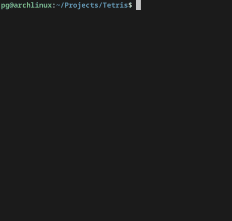

# Tetris (Terminal / NES Edition)

<div align="center">


**An authentic NES-style Tetris clone built from scratch in C for your terminal.**

<br/>

</div>

---

## Highlights

- **Authentic NES Feel**: Modeled after Nintendo's classic 1989 NES Tetris — complete with level-based gravity curves, authentic scoring formulas, and line-clear animations.
- **Real-Time Statistics**: Live on-screen counters tracking how many of each tetromino ($I, J, L, O, S, T, Z$) have spawned during your run.
- **Lightweight & High-Performance**: Written in pure C11 using single-header libraries. Minimal CPU overhead and responsive 60 FPS terminal rendering.
- **TUI Graphics**: Run on any terminal, including the TTY thanks to [termbox2](https://github.com/termbox/termbox2).
Uses UTF-8 double-border box characters and ANSI colors for crisp rendering across modern terminal emulators.
- **Sound Ready**: Integrated audio subsystem powered by [miniaudio](https://miniaud.io/).

---

## Controls

| Key | Action |
|:---:|:---|
| <kbd>←</kbd> | Move Left |
| <kbd>→</kbd> | Move Right |
| <kbd>↓</kbd> | Soft Drop (awards bonus points) |
| <kbd>Z</kbd> | Rotate Counter-Clockwise |
| <kbd>X</kbd> | Rotate Clockwise |
| <kbd>P</kbd> | Pause / Resume |
| <kbd>Q</kbd> | Quit Game |

---

## 📐 Scoring System

Faithfully implemented following the original NES Tetris scoring guidelines, scaled by the current level:

| Cleared Lines | Base Points | Multiplied Score |
|:---:|:---:|:---|
| **1 (Single)** | 40 | $40 \times (\text{Level} + 1)$ |
| **2 (Double)** | 100 | $100 \times (\text{Level} + 1)$ |
| **3 (Triple)** | 300 | $300 \times (\text{Level} + 1)$ |
| **4 (Tetris)** | 1200 | $1200 \times (\text{Level} + 1)$ |

> *Tip: Soft drops award $+1$ bonus point per cell traversed!*

---

## Code Organization

```
.
├── include/              # [miniaudio](https://miniaud.io/) and [termbox2](https://github.com/termbox/termbox2) headers
├── src/
│   ├── background.c      # Matrix state, line detection & compaction
│   ├── config.h          # Board dimensions, colors, frame rates
│   ├── main.c            # Game loop & event dispatcher
│   ├── play_screen.c     # Gameplay logic, NES scoring & rendering
│   ├── tetromino.c       # Tetromino definitions & rotation matrices
│   ├── timer.c           # Precise millisecond game timers
│   └── tetris.h          # Global declarations & types
├── res/                  # Visual preview and audio assets
└── Makefile              # Build rules
```

---

## Getting Started

### Prerequisites

Ensure you have a C compiler and standard development tools installed:

- **GCC** or **Clang** (supporting C11)
- **Make**
- **libm** (standard on most Linux/POSIX environments. You probably have it already)

On Debian/Ubuntu:
```bash
sudo apt-get install build-essential
```

On Fedora:
```bash
sudo dnf groupinstall "Development Tools"
```

On Arch Linux:
```bash
sudo pacman -S base-devel
```

### Installation & Launch

1. **Clone the repository:**
   ```bash
   git clone https://github.com/pgvalle/Tetris.git
   cd Tetris
   ```

2. **Compile the project:**
   ```bash
   make
   ```

3. **Play:**
   ```bash
   make run
   # or run directly:
   ./tetris
   ```

---

## Todos

- [ ] Use audio properly with acceleration effect to keep up with level speed
- [ ] Menu screen to configure starting level, music, ...

---

## License

This project is open-source under the [MIT License](LICENSE).
